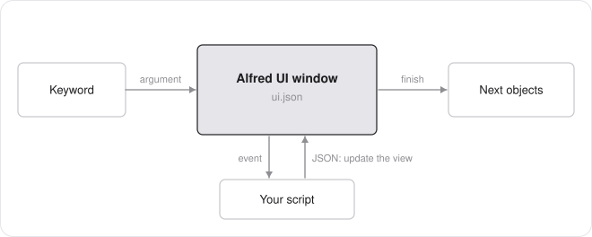
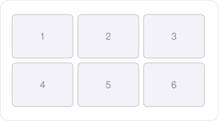
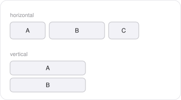
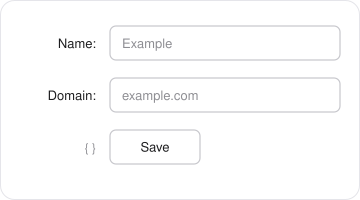
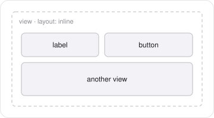
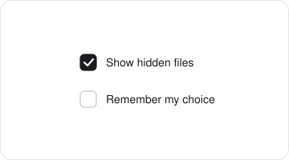
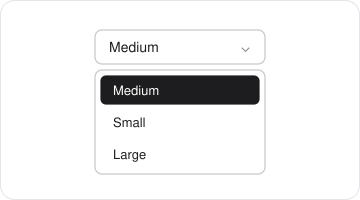
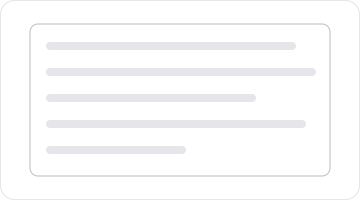
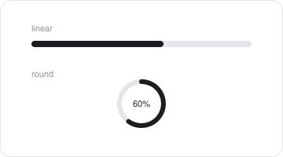
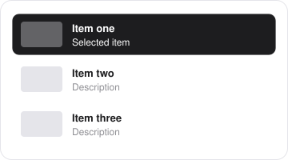

# Alfred UI skill

An [Agent Skill](https://agentskills.io) for building **Alfred UI** windows, the Alfred 6 feature that lets a workflow open its own window from a `ui.json` file. Alfred UI is newer than the training data of current models, so without this skill agents guess.

## Install

```sh
npx skills add Hemmingsson/alfred-ui-skill
```

Needs Alfred 6 with the Powerpack.

## Alfred UI



1. A keyword or hotkey opens the window and hands it what you typed.
2. The window is a tree of **components** arranged by **layouts**.
3. Components fire **events** (clicked, changed, typing stopped). An event runs an **action**: a JSON command, a component function, or a script that prints one JSON action, such as "put these rows in the list".
4. A `finish` action closes the window and passes a result on to the next workflow objects.

The full schema is in [`references/`](skills/alfred-ui/references).

### Layouts

Every container is a `view`; its `layout` places the children.

<table>
<tr><td></td><td><strong><code>stack</code></strong>: children overlap and each fills the view; the first is at the bottom. A placeholder under a web page, or swapped views.</td></tr>
<tr><td></td><td><strong><code>border</code></strong>: <code>top</code>, <code>bottom</code>, <code>left</code>, <code>right</code> take what they need; <code>centre</code> gets the rest. The usual window frame.</td></tr>
<tr><td></td><td><strong><code>grid</code></strong>: <code>rows</code> × <code>cols</code> equal cells, filled row by row.</td></tr>
<tr><td></td><td><strong><code>inline</code></strong>: one after another, <code>horizontal</code> or <code>vertical</code>, each child at its own size.</td></tr>
<tr><td></td><td><strong><code>form</code></strong>: label, field pairs; <code>{}</code> leaves a cell blank.</td></tr>
<tr><td></td><td><strong><code>flex</code></strong>: a grid where each child sets its <code>col</code>, <code>row</code>, spans and weights.</td></tr>
</table>

### Components

**Events** are what a component reports, **functions** what you can tell it to do, **read** what `{value:id.property}` returns.

<table>
<tr><td></td><td><strong><code>view</code></strong>: a container with a layout, background, corner radius and padding.</td></tr>
<tr><td></td><td><strong><code>label</code></strong>: read-only text.<br>Read: <code>text</code></td></tr>
<tr><td></td><td><strong><code>button</code></strong>: text, an image or SF Symbol, or both.<br>Events: <code>actioned</code><br>Read: <code>text</code>, <code>image</code></td></tr>
<tr><td></td><td><strong><code>checkbox</code></strong>: an on/off option.<br>Events: <code>changed</code><br>Read: <code>checked</code>, <code>text</code></td></tr>
<tr><td></td><td><strong><code>picker</code></strong>: one item from a popup list.<br>Events: <code>changed</code><br>Functions: <code>selectfirst</code>, <code>selectlast</code>, <code>selectprevious</code>, <code>selectnext</code><br>Read: <code>selected.text</code>, <code>selected.value</code></td></tr>
<tr><td></td><td><strong><code>textfield</code></strong>: one line of input, usually the search field.<br>Events: <code>changed</code>, <code>typingstopped</code>, <code>actioned</code> (Return)<br>Read: <code>text</code></td></tr>
<tr><td></td><td><strong><code>passwordfield</code></strong>: a text field that hides its input.<br>Read: <code>text</code></td></tr>
<tr><td></td><td><strong><code>textarea</code></strong>: several lines, editable or read-only.<br>Events: <code>changed</code>, <code>typingstopped</code><br>Functions: <code>scrolltop</code>, <code>scrollbottom</code>, <code>caretstart</code>, <code>caretend</code><br>Read: <code>text</code></td></tr>
<tr><td></td><td><strong><code>markdownarea</code></strong>: rendered Markdown with clickable links.<br>Read: <code>text</code></td></tr>
<tr><td></td><td><strong><code>progress</code></strong>: a bar or ring from 0 to 1.<br>Read: <code>progress</code></td></tr>
<tr><td></td><td><strong><code>imageview</code></strong>: an image file, a file icon or an SF Symbol. No IMAGE type is documented to take a URL; download to the cache and pass a path.<br>Read: <code>image</code></td></tr>
<tr><td></td><td><strong><code>dataview</code></strong>: the list or grid. You design one cell, then give one data object per row. <code>filterdata</code> filters it; <code>changed</code> fires on selection.<br>Events: <code>changed</code><br>Functions: <code>filterdata</code>, <code>selectfirst</code>, <code>selectlast</code>, <code>selectprevious</code>, <code>selectnext</code>, <code>scrolltop</code>, <code>scrollbottom</code>, … (<a href="skills/alfred-ui/references/components.md#dataview">all</a>)<br>Read: <code>{value:list.selected.title.text}</code></td></tr>
<tr><td></td><td><strong><code>webkitview</code></strong>: a web page from a URL, a file or HTML. It reports when navigation starts, not when loading ends.<br>Events: <code>changed</code><br>Functions: <code>back</code>, <code>forward</code>, <code>reload</code><br>Read: <code>src</code></td></tr>
</table>

Not drawn: **templates** (a component defined once, reused with parameters) and **`{file:…}`** (split `ui.json` into files).

## Skill files

| Path | Contents |
| --- | --- |
| [`skills/alfred-ui/SKILL.md`](skills/alfred-ui/SKILL.md) | Entry point for agents: build steps and contracts |
| [`references/components.md`](skills/alfred-ui/references/components.md) | Components, layouts, constraints and property types |
| [`references/ui-json.md`](skills/alfred-ui/references/ui-json.md) | Top-level keys, placeholders, variables, actions, JSON commands, pulse, logging |
| [`references/workflow.md`](skills/alfred-ui/references/workflow.md) | The `info.plist` object, inputs, outputs, routing, packaging, testing |
| [`references/examples.md`](skills/alfred-ui/references/examples.md) | Public Alfred UI workflows by pattern, idioms, design notes |
| [`scripts/check_ui.py`](skills/alfred-ui/scripts/check_ui.py) | The checker |
| [`agents/openai.yaml`](skills/alfred-ui/agents/openai.yaml) | Codex metadata |
| [`tools/wireframes.py`](tools/wireframes.py) | Draws the wireframes: `python3 tools/wireframes.py` |
