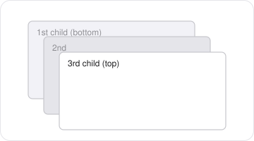
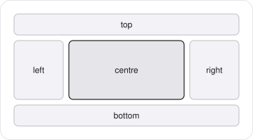
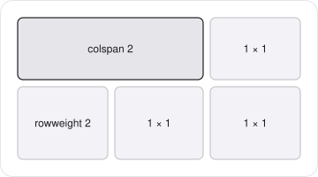
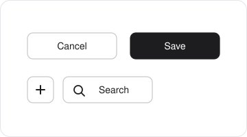
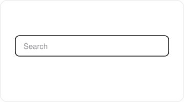
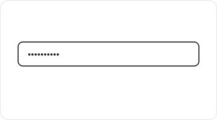
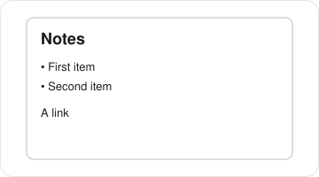

# Alfred UI skill

An [Agent Skill](https://agentskills.io) for building **Alfred UI** windows, the Alfred 6 feature that lets a workflow open its own window from a `ui.json` file. Alfred UI is newer than the training data of current models, so without this skill agents guess.

## Install

```sh
npx skills add Hemmingsson/alfred-ui-skill
```

Needs Alfred 6 with the Powerpack.

## Alfred UI


1. A keyword or hotkey opens the window and hands it what you typed.
2. The window is a tree of **components** arranged by **layouts**.
3. Components fire **events** (clicked, changed, typing stopped). An event runs an **action**: a JSON command, a component function, or a script that prints one JSON action, such as "put these rows in the list".
4. A `finish` action closes the window and passes a result on to the next workflow objects.

The full schema is in [`references/`](skills/alfred-ui/references).

### Layouts

Every container is a `view`; its `layout` places the children.

| Wireframe | Layout |
| --- | --- |
|  | **`stack`**: children overlap and each fills the view; the first is at the bottom. A placeholder under a web page, or swapped views. |
|  | **`border`**: `top`, `bottom`, `left`, `right` take what they need; `centre` gets the rest. The usual window frame. |
|  | **`grid`**: `rows` × `cols` equal cells, filled row by row. |
|  | **`inline`**: one after another, `horizontal` or `vertical`, each child at its own size. |
|  | **`form`**: label, field pairs; `{}` leaves a cell blank. |
|  | **`flex`**: a grid where each child sets its `col`, `row`, spans and weights. |

### Components

**Events** are what a component reports, **functions** what you can tell it to do, **read** what `{value:id.property}` returns.

| Wireframe | Component |
| --- | --- |
|  | **`view`**: a container with a layout, background, corner radius and padding. |
|  | **`label`**: read-only text.<br>Read: `text` |
|  | **`button`**: text, an image or SF Symbol, or both.<br>Events: `actioned`<br>Read: `text`, `image` |
|  | **`checkbox`**: an on/off option.<br>Events: `changed`<br>Read: `checked`, `text` |
|  | **`picker`**: one item from a popup list.<br>Events: `changed`<br>Functions: `selectfirst`, `selectlast`, `selectprevious`, `selectnext`<br>Read: `selected.text`, `selected.value` |
|  | **`textfield`**: one line of input, usually the search field.<br>Events: `changed`, `typingstopped`, `actioned` (Return)<br>Read: `text` |
|  | **`passwordfield`**: a text field that hides its input.<br>Read: `text` |
|  | **`textarea`**: several lines, editable or read-only.<br>Events: `changed`, `typingstopped`<br>Functions: `scrolltop`, `scrollbottom`, `caretstart`, `caretend`<br>Read: `text` |
|  | **`markdownarea`**: rendered Markdown with clickable links.<br>Read: `text` |
|  | **`progress`**: a bar or ring from 0 to 1.<br>Read: `progress` |
|  | **`imageview`**: an image file, a file icon or an SF Symbol. No IMAGE type is documented to take a URL; download to the cache and pass a path.<br>Read: `image` |
|  | **`dataview`**: the list or grid. You design one cell, then give one data object per row. `filterdata` filters it; `changed` fires on selection.<br>Events: `changed`<br>Functions: `filterdata`, `selectfirst`, `selectlast`, `selectprevious`, `selectnext`, `scrolltop`, `scrollbottom`, … ([all](skills/alfred-ui/references/components.md#dataview))<br>Read: `{value:list.selected.title.text}` |
|  | **`webkitview`**: a web page from a URL, a file or HTML. It reports when navigation starts, not when loading ends.<br>Events: `changed`<br>Functions: `back`, `forward`, `reload`<br>Read: `src` |

Not drawn: **templates** (a component defined once, reused with parameters) and **`{file:…}`** (split `ui.json` into files).

## Skill files

| Path | Contents |
| --- | --- |
| [`skills/alfred-ui/SKILL.md`](skills/alfred-ui/SKILL.md) | Entry point for agents: build steps and contracts |
| [`references/components.md`](skills/alfred-ui/references/components.md) | Components, layouts, constraints and property types |
| [`references/ui-json.md`](skills/alfred-ui/references/ui-json.md) | Top-level keys, placeholders, variables, actions, JSON commands, pulse, logging |
| [`references/workflow.md`](skills/alfred-ui/references/workflow.md) | The `info.plist` object, inputs, outputs, routing, packaging, testing |
| [`references/examples.md`](skills/alfred-ui/references/examples.md) | Public Alfred UI workflows by pattern, idioms, design notes |
| [`scripts/check_ui.py`](skills/alfred-ui/scripts/check_ui.py) | The checker |
| [`agents/openai.yaml`](skills/alfred-ui/agents/openai.yaml) | Codex metadata |
| [`tools/wireframes.py`](tools/wireframes.py) | Draws the wireframes: `python3 tools/wireframes.py` |

## License

MIT. Alfred is a product of Running with Crayons Ltd; this project is not affiliated with it.
